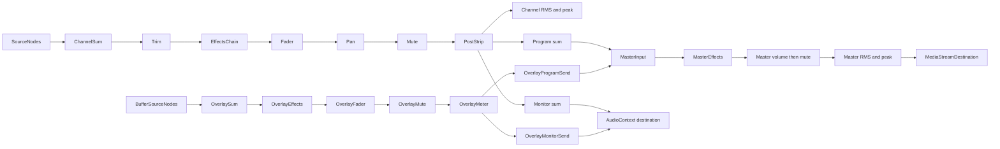

# Browser audio engine

The project document owns the mix. The browser engine in `layers/studio/app/infrastructure/audio/` only plays that document. It is not MoonBase Bridge and it does not publish RTMP. Bridge still renders Program Output. This graph is the editor's program audio: one `MediaStream` after the master, plus a separate headphone bus.

Domain types stay free of Web Audio nodes ([ADR-009](./decisions.md)). Field lists are in [data-models.md](./data-models.md).

## What a channel is

`AudioChannel` lives on `project.audioMixer` and is the same strip in every scene. A channel owns `sourceIds`. Those sources are summed, then the strip runs once. A source belongs to at most one channel.

`audioVisual` does not have a fader. It stores `channelId`. A visible layer in the active scene enables that channel. A channel with `global` stays enabled on every scene, so a microphone or a system-audio capture added from the sound list is heard whether or not a scene also has a layer for it. Adding that source to a scene reuses the same channel and the same capture.

`trimDb` (−24…+24) and `faderDb` (−60…+12, unity at 0) are separate. `pan`, `muted`, `solo`, and `monitoring` (`off` | `monitor` | `monitor-and-output`) are on the channel. `syncOffsetMs` (−1000…1000) is stored and not applied. `filters` stay in the file and the engine ignores them. `effects` is the typed insert: `eq-band`, `high-pass`, `compressor`, `noise-gate`, `limiter`. One EQ band is one effect, so the array order is the chain order. A disabled effect is a bypass.

`AudioMaster` has `effects` as well, defaulting to an empty list when an older file omits it. The file stays format 3. User presets live on `audioMixer.presets` and do not move to another project by themselves. System presets stay in code until someone applies one.

## Graph

The channel meter and both sends read `PostStrip`, so mute silences the meter, the program, and the headphones. Solo does not bypass mute.

The master meter reads the same node that feeds the single `MediaStreamAudioDestinationNode`. That stream is not played through the speakers.

## Monitor and solo

Program send, for a channel enabled in the active scene:

- `monitoring: 'off'` and `'monitor-and-output'` go to the program
- `monitoring: 'monitor'` stays off the program
- solo never changes this send

Headphone send, from `PostStrip`, not through the master:

- no solo in the active scene: channels whose monitoring is not `off`
- any solo in the active scene: only the soloed channels

Solo outside the active scene does not steal the headphones. `sceneHasSolo` counts channels only.

The overlay bus uses the same monitoring values. Its program send also enters the master input, before master effects, volume, mute, and the program meter. Its headphone send enters the monitor sum and skips the master. Mute on the bus is in front of that split, so it silences both. Solo on the bus does not remove channels from the headphones. A soloed channel removes the bus from the headphones unless the bus is solo too. Neither solo changes a program send.

## Overlay sounds

Overlay sounds are project data on `audioMixer.overlay`. Playback is session state: one `AudioBuffer` per asset signature, many `AudioBufferSourceNode` voices, and a per-sound queue of at most 8. A second start of the same asset does not decode again. The buffer stays while a sound still points at that asset or a voice is still playing. A local file is a session object URL. `storageKey` is not a disk path. A missing file is a playback error. The preview mixer only shows the overlay meter. The sound list sits under the scene list, and the selected sound opens in the inspector together with the shared bus output. That selection is editor state and is not written into the project file.

`allow` adds a voice until the sound limit and the bus limit. `restart` replaces that sound's voices. `ignore` does nothing while one is playing. `queue` waits. Cooldown rejects the call before a voice or a queue entry. `stop-all`, a restart-policy change, and disabling the sound clear that queue.

Changing the active scene follows `sceneChangePolicy`. `continue` leaves voices running. `stop-all-overlay-sounds` stops every voice. `stop-scene-sounds` stops voices that were started for the scene being left. A manual play has no scene id, so that policy leaves it running.

Cues are `dispatchOverlayCue` / `subscribeOverlayCues`. A trigger matches the event and, when set, the scene and the element. The studio session holds one subscription. Overlay elements do not emit these cues yet. Alert names (`follow`, `subscription`, `donation`, `raid`, `cheer`, `chat`, and `custom`) are the same cue events, so a trigger can bind a sound to one of them.

An alert may also carry `sound`: an `https` URL and a volume in dB. Studio plays that file once on the overlay bus, through the same buffer cache and voice path as a library sound. The renderer stays silent.

A browser layer has a sound switch. Turning it on asks the browser to share this tab and adds one global channel for that tab audio. A cross-origin page such as StreamElements plays inside the frame; the share is what puts that audio on the strip, the meter, and the program mix. The capture asks the browser to leave the studio's own mix out and to keep the page from also playing through the speakers. Monitor on the strip is what plays it back. The share starts from the switch or the connect button. Loading a project does not open it. Every browser layer that wants sound uses that same channel, because the browser hands over one tab mix.

## Overlay Lab

`/dev/overlay-lab` publishes alert messages. `/overlay/:overlayId` is a transparent page for a second tab or an OBS browser source. Both sides use one transport, `BroadcastChannel` named `moonbase-overlay-events`, behind `OverlayEventPort`. When that API is missing, the lab shows the transport as unavailable and does not pretend the tabs are connected.

Studio is the only listener that turns an alert into `dispatchOverlayCue`. The existing cue subscription then calls the overlay playback controller. The lab never calls `play()`. The renderer never creates an audio context. Studio publishes the overlay meter, which is the analyser already on the overlay bus, plus the playback trace. Headphones and the program mix stay on the one studio graph.

A renderer shows one alert at a time and queues the rest. Text is rendered as text. Avatar URLs have to be `http` or `https`.

The channel is a developer stand-in. A later Bridge or Core source can publish the same messages. OBS browser sources do not all implement `BroadcastChannel`; the connection badges are there so a silent transport is visible.

## Where the controls live

The preview mixer meters channels, the overlay bus, and the master. It does not edit the overlay library, and it does not pick the headphone device. `setMonitorSink` remains on the engine for a later options screen.

Global microphones, system or app audio, and overlay sounds are listed under the scene list. Selecting one opens the inspector. A layer selection hides that inspector. Selecting any layer clears the overlay-sound selection and the global-channel selection. Those two ids are editor state and are not written into the project file.

Channel effects, presets, and the stored filter list are on the second inspector rail. That rail does not configure the master. The audio inspector does not show the add-effect card that other element types still use. A preset reads as applied when the channel strip and its chain match the preset. Monitoring stays `off` until the operator turns it on. Choosing a microphone does not turn monitoring on.

A file added from the global list becomes an audio asset plus an overlay sound. Playback uses a session object URL for a local file and `remoteUrl` when the asset already has one. The overlay meter moves when the bus is unmuted, including when monitoring is `off`. Speakers follow the bus monitoring control.

## Foreign overlay pages

A page inside the browser frame does not emit Studio cues. `BroadcastChannel` does not cross origins, so a StreamElements or Streamlabs overlay never calls `dispatchOverlayCue` and never delivers `sound.url`. Widgets on that page keep their own audio. The browser-layer sound switch is how that tab mix reaches a strip. Studio does not open a vendor realtime socket.

An alert file plays only when Studio receives a message on `moonbase-overlay-events` whose alert includes an `https` sound URL, or when a trigger matches a cue. The renderer stays silent either way.

## Capture is not registration

A source in the project does not open a device. `getUserMedia`, `getDisplayMedia`, and file playback start only from a user gesture. Screen or tab audio is never opened while loading a project or changing scenes.

After a successful start the stream stays for the session. Scene changes only retarget program and monitor sends. The source node is not reconnected when a fader moves. The device closes when the source leaves the project or the engine session ends.

Microphone capture asks the browser to turn off echo cancellation, noise suppression, and automatic gain. Those defaults chop speech and dull the tone.

Device inventory is session state. It is not stored in the project. An unnamed list before permission is a hidden-label state, not a device error. Losing a microphone leaves the source, the channel, and the effects in place. A new `getUserMedia` replaces the stream on that same channel input. `getDisplayMedia` starts only from the button and is never resumed by itself.

Headphone output uses `AudioContext.setSinkId` when the browser has it. That changes `destination` only. The program `MediaStreamDestination` stays where it is. Without the API, playback stays on the default output and the UI says so.

## Effects

The insert between trim and fader, and the insert between the program sum and master volume, build only the enabled effects. Reordering crossfades to a new chain and then drops the old nodes. The source node and the program stream stay connected.

EQ and high-pass are `BiquadFilterNode`. The curve is `getFrequencyResponse`. The compressor is `DynamicsCompressorNode` plus a separate makeup gain. Its reduction readout is the node's `reduction`. The gate and the limiter are audio worklets. The limiter is not a compressor with a high ratio. Its lookahead is a `DelayNode` of about 5 ms inside that insert, and the UI says so.

## Meters

Each analyser reports RMS and peak in dB, floored at −60. Channel meters and the overlay meter sit after mute. The master meter sits after master volume and master mute. UI ballistics smooth the RMS and hold the peak. They do not change the audio.

## Migration

`ProjectFile` is format 3. A v2 file is upgraded in memory. Scene strips for the same source become one channel when they agree. When they differ, the channel is written neutral (`monitoring: 'off'` included) and the session keeps a conflict report. Save stays blocked until that report is dismissed. The migration does not write the file.

## Not in this graph

Twitch, YouTube, webhooks, and the Bridge mix. Studio does not authenticate to a StreamElements or Streamlabs socket. `syncOffsetMs` is stored and not applied. `filters` are kept so older files still open. Overlay scene elements do not yet emit `shown`, `hidden`, `animation-start`, `animation-complete`, or `interaction`. Alert cues arrive only through the lab transport. Per-application audio is the browser or system share picker, not a list of processes. Tab capture is one mix, so every browser layer that wants sound shares one channel. `getDisplayMedia` exists only in a secure context, so a plain `http` address on a LAN host cannot start that share.
