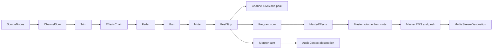

# Browser audio engine

The project document owns the mix. The browser engine in `layers/studio/app/infrastructure/audio/` only plays that document. It is not MoonBase Bridge and it does not publish RTMP. Bridge still renders Program Output. This graph is the editor's program audio: one `MediaStream` after the master, plus a separate headphone bus.

Domain types stay free of Web Audio nodes ([ADR-009](./decisions.md)). Field lists are in [data-models.md](./data-models.md).

## What a channel is

`AudioChannel` lives on `project.audioMixer` and is the same strip in every scene. A channel owns `sourceIds`. Those sources are summed, then the strip runs once. A source belongs to at most one channel.

`audioVisual` does not have a fader. It stores `channelId`. A visible layer in the active scene enables that channel. Adding the same source to another scene reuses the channel instead of creating a second strip.

`trimDb` (−24…+24) and `faderDb` (−60…+12, unity at 0) are separate. `pan`, `muted`, `solo`, and `monitoring` (`off` | `monitor` | `monitor-and-output`) are on the channel. `syncOffsetMs` (−1000…1000) is stored and not applied. `filters` stay in the file and the engine ignores them. `effects` is the typed insert: `eq-band`, `high-pass`, `compressor`, `noise-gate`, `limiter`. One EQ band is one effect, so the array order is the chain order. A disabled effect is a bypass.

`AudioMaster` has `effects` as well, defaulting to an empty list when an older file omits it. The file stays format 3. User presets live on `audioMixer.presets` and do not move to another project by themselves. System presets stay in code until someone applies one.

## Graph

The channel meter and both sends read `PostStrip`, so mute silences the meter, the program, and the headphones. Solo does not bypass mute.

The master meter reads the same node that feeds the single `MediaStreamAudioDestinationNode`. That stream is not played through the speakers.

## Monitor and solo

Program send, for a channel enabled in the active scene:

- `monitoring: 'off'` and `'monitor-and-output'` go to the program
- `monitoring: 'monitor'` stays off the program
- solo never changes this send

Headphone send, from `PostStrip`, not through the master:

- no solo in the active scene: channels whose monitoring is not `off`
- any solo in the active scene: only the soloed channels

Solo outside the active scene does not steal the headphones.

## Capture is not registration

A source in the project does not open a device. `getUserMedia`, `getDisplayMedia`, and file playback start only from a user gesture. Screen or tab audio is never opened while loading a project or changing scenes.

After a successful start the stream stays for the session. Scene changes only retarget program and monitor sends. The source node is not reconnected when a fader moves. The device closes when the source leaves the project or the engine session ends.

Microphone capture asks the browser to turn off echo cancellation, noise suppression, and automatic gain. Those defaults chop speech and dull the tone.

Device inventory is session state. It is not stored in the project. An unnamed list before permission is a hidden-label state, not a device error. Losing a microphone leaves the source, the channel, and the effects in place. A new `getUserMedia` replaces the stream on that same channel input. `getDisplayMedia` starts only from the button and is never resumed by itself.

Headphone output uses `AudioContext.setSinkId` when the browser has it. That changes `destination` only. The program `MediaStreamDestination` stays where it is. Without the API, playback stays on the default output and the UI says so.

## Effects

The insert between trim and fader, and the insert between the program sum and master volume, build only the enabled effects. Reordering crossfades to a new chain and then drops the old nodes. The source node and the program stream stay connected.

EQ and high-pass are `BiquadFilterNode`. The curve is `getFrequencyResponse`. The compressor is `DynamicsCompressorNode` plus a separate makeup gain. Its reduction readout is the node's `reduction`. The gate and the limiter are audio worklets. The limiter is not a compressor with a high ratio. Its lookahead is a `DelayNode` of about 5 ms inside that insert, and the UI says so.

## Meters

Each analyser reports RMS and peak in dB, floored at −60. Channel meters sit after mute. The master meter sits after master volume and master mute. UI ballistics smooth the RMS and hold the peak. They do not change the audio.

## Migration

`ProjectFile` is format 3. A v2 file is upgraded in memory. Scene strips for the same source become one channel when they agree. When they differ, the channel is written neutral (`monitoring: 'off'` included) and the session keeps a conflict report. Save stays blocked until that report is dismissed. The migration does not write the file.

## Not in this graph

Overlay sounds and the Bridge mix. `syncOffsetMs` is stored and not applied. `filters` are kept so older files still open.
