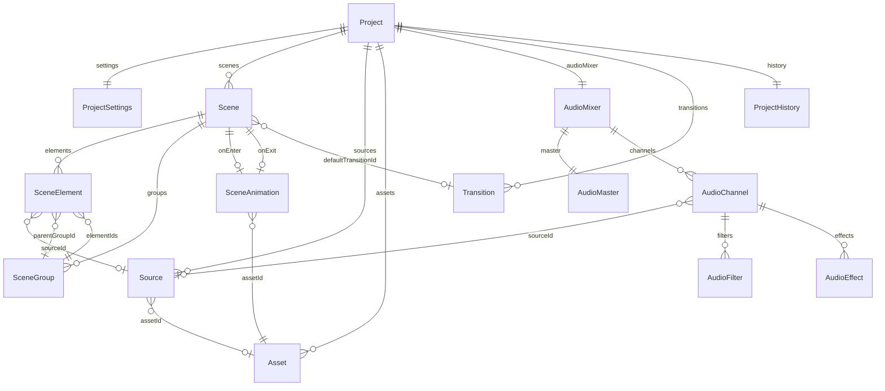
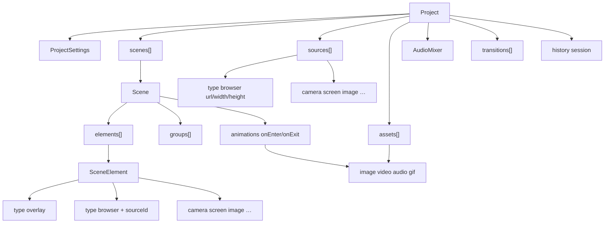
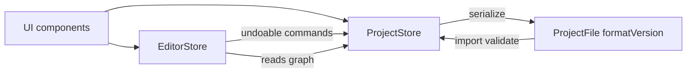
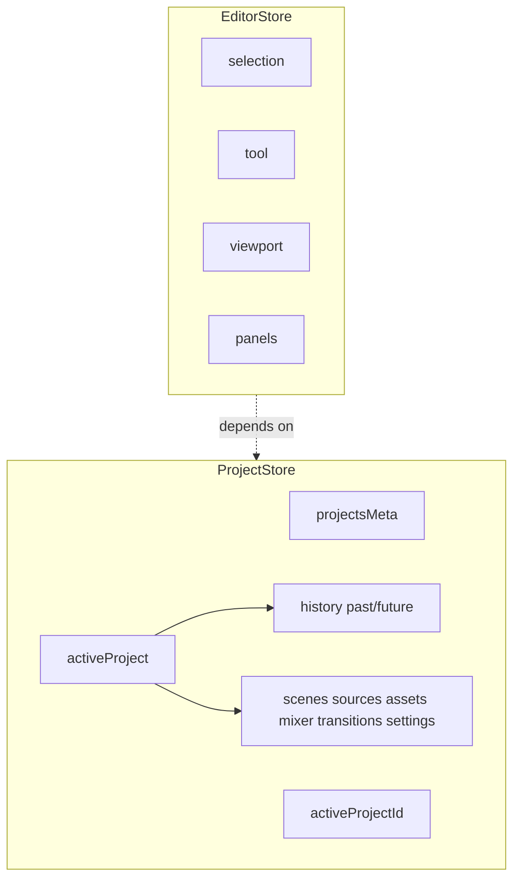
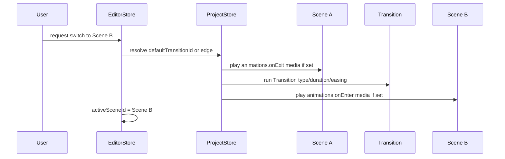
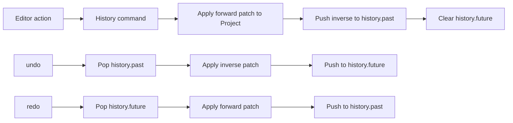

# Architecture Diagrams — MoonBase Studio

## 1. Model relationships

Ownership (solid) vs ID references (dashed conceptually via labels).

## 2. Project structure (ownership hierarchy)

Sources and assets are siblings of scenes under Project — not nested under Scene. Elements only reference them by ID.

## 3. Store responsibilities and dependencies

## 4. Scene transition flow

Notes:

- `Transition` = inter-scene effect from `Project.transitions[]`.
- `SceneAnimation` = GIF/video asset on enter/exit — not the same model as `Transition`.

## 5. Undo / Redo flow

History is session-scoped on `Project.history` and omitted from `ProjectFile`.
